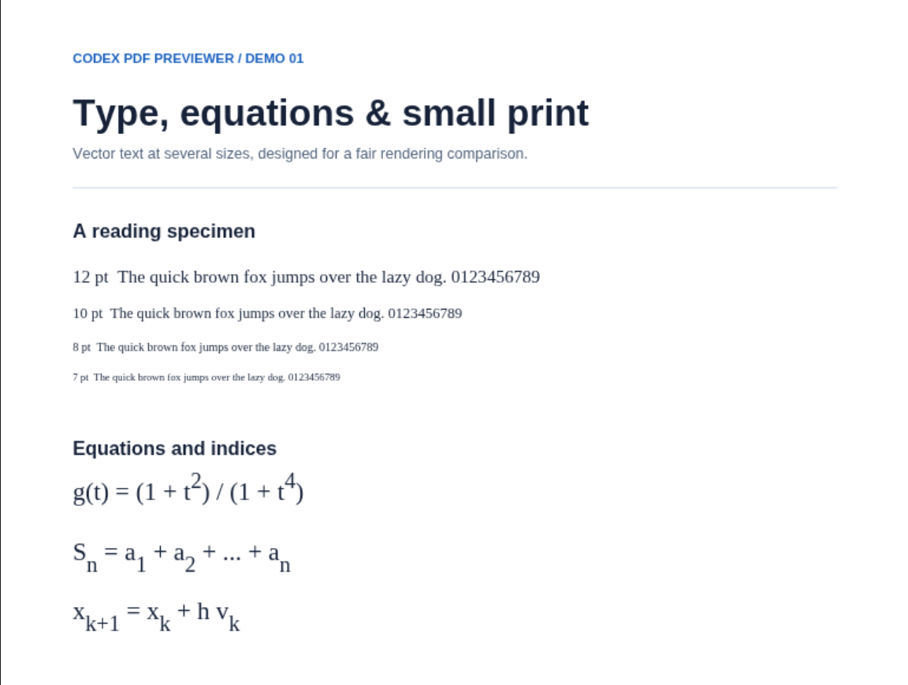
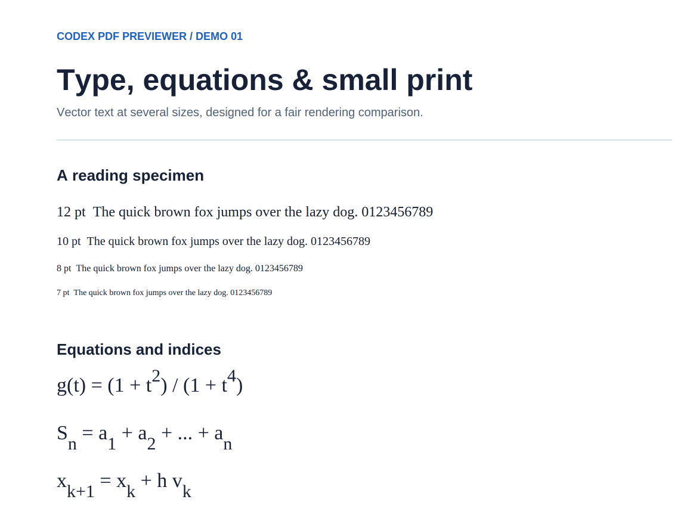
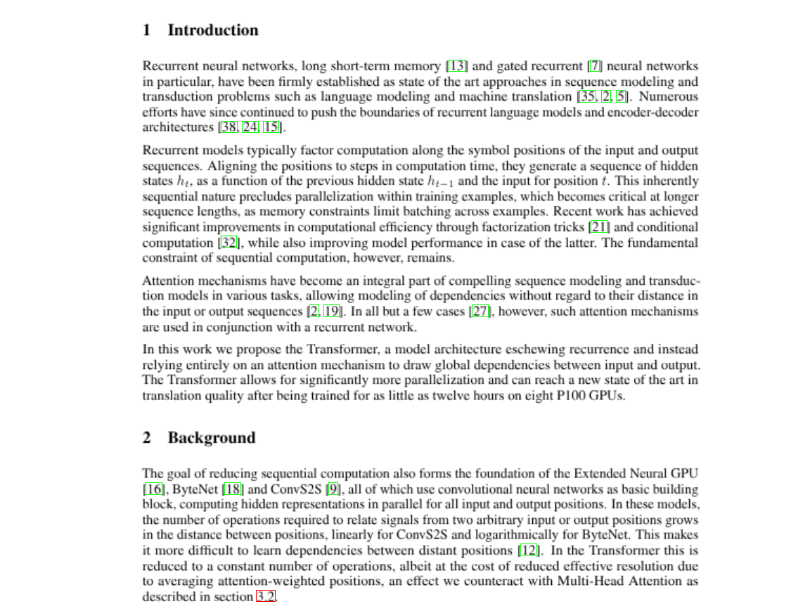
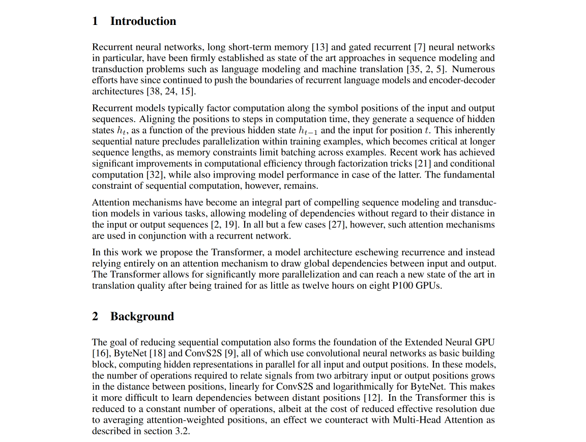

# codex-pdf-previewer

**Are you tired of blurry PDF previews in Codex, especially on a large monitor?**

Sharper local PDF previews, inside Codex.

## Install

[Download ZIP](https://github.com/luny-moon/codex-pdf-previewer/releases/download/v1.6.0/codex-pdf-previewer-1.6.0.zip) · macOS / Windows / Linux

Send the ZIP or this GitHub page to Codex and say:

> Install this plugin for me.

Requires Codex desktop and Python 3.10+. Restart Codex if the plugin is not yet visible.

## Open a PDF

**macOS (preview) / Linux:** the installer adds **Open in → 用高清 PDF 插件打开** to the PDF menu on supported desktop clients. Select it to open a new HD preview tab while keeping the original preview.

**All systems:** attach a PDF and say **“Open this PDF.”** Windows currently uses this chat opening flow; its Codex PDF menu has no supported plugin entry.

## Preview

<table>
<tr><th>Codex default preview</th><th>codex-pdf-previewer</th></tr>
<tr>
<td></td>
<td></td>
</tr>
</table>

<table>
<tr><th>Codex default preview</th><th>codex-pdf-previewer</th></tr>
<tr>
<td></td>
<td></td>
</tr>
</table>

## License

[MIT](LICENSE) · [Third-party notices](plugins/codex-pdf-previewer/THIRD_PARTY.md) · [Image credits](docs/comparisons/SOURCES.md)
